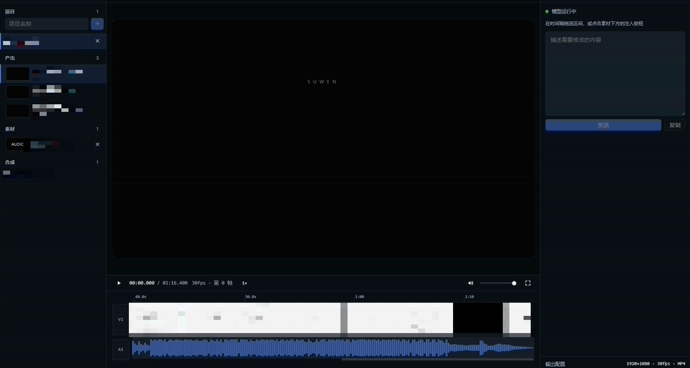

# HyperFrames 工作台

把 [HyperFrames](https://github.com/heygen-com/hyperframes)（HTML → MP4 的确定性渲染）搬进 DeepSeek Harness 对话里的视频工作台插件。

在对话顶部多一个 `HyperFrames` 标签：左边管项目和素材，中间是播放器和时间轴，右边是提示词注入。选中时间轴区间或素材，一句话发给模型，模型改 HTML 合成、渲染 MP4，产出自动回到左侧列表。



## 功能

- **项目即目录**：每个项目是 `<工作区>/hyperframes/<项目名>/`，目录结构固定（见下）
- **产出一栏**：扫描 `output/*.mp4`，带缩略图、大小，可播放、可删除（带确认）
- **素材一栏**：图片/视频/音频，点击预览，右键或下方按钮注入提示词
- **时间轴**：刻度尺、ffmpeg 生成的真实缩略图（16:9，带分割线）、音频波形、拖拽选区、区间内播放、倍速、音量、全屏；轨道按秒展开，支持滚轮横向滚动
- **提示词注入**：选区/素材生成带**绝对路径**的引用块；`发送` 只发消息，`发送并渲染` 追加输出规格、渲染命令与目录约定
- **运行状态**：实时显示 `正在调用 <工具> · 已用 3分12秒` / `已完成 · 用时 4分01秒`
- **依赖自检**：Node / HyperFrames / FFmpeg / 渲染浏览器四项，缺什么就在画面上拦着并给一键安装
- **输出配置**：分辨率、帧率、格式、渲染浏览器，存进项目的 `project.json`

## 项目目录约定

每个项目自动生成这套结构，注入给模型的提示词里也会重复一遍，避免文件乱丢：

| 路径 | 用途 |
|---|---|
| `index.html` | 主合成，渲染入口 |
| `compositions/` | 可复用的子合成 |
| `assets/images/` | 图片素材 |
| `assets/video/` | 视频素材 |
| `assets/audio/` | 音频素材 |
| `assets/fonts/` | 字体 |
| `assets/vendor/` | 第三方库（如 gsap），不用 CDN |
| `scripts/` | 生成 / 批处理脚本，可重复运行 |
| `work/` | 中间产物（抽帧、临时片段、截图），可随时清理 |
| `output/` | 最终成片，只放 MP4 |
| `.cache/` | 工作台缓存，勿读写 |

## 安装

插件本体就是一个标准 DSH bundle，包名 `dsh-hyperframes`。

```bash
git clone https://github.com/Lenox-L/dsh-hyperframes.git dsh-hyperframes
```

然后在 DSH 里用插件管理器安装目录（绝对路径）：

```
plugin_manager  action=install_bundle  target=<abs path to dsh-hyperframes>
```

或者手动把它写进 profile：`package.json` 的 `dsh.profile.bundles` 加上 `dsh-hyperframes`，`dependencies` 加上 `"dsh-hyperframes": "link:<绝对路径>"`，再 `pnpm install`。

装完重启 DSH（首次装会热启用），对话顶部就会出现 `HyperFrames` 标签。

## 依赖

| 依赖 | 说明 |
|---|---|
| Node.js ≥ 22 | 渲染 CLI 的要求 |
| hyperframes | `npm i -g hyperframes`（工作台内的「安装依赖」会自动做） |
| FFmpeg + FFprobe | 渲染必需；工作台会自动装到 `C:\ffmpeg\bin` 并写入用户 PATH |
| Chromium 内核浏览器 | Chrome / Edge / Chromium 任一；会自动探测，起不来的会被跳过 |

浏览器在「输出配置」里可以手动指定，避免自动探测选到坏掉的那一个。

## 目录结构

```
dsh-hyperframes/
├── package.json        # dsh.bundle.patch + dsh.client
├── cordis.patch.yml    # 把插件插进组合
├── index.js            # Host：项目/依赖/媒体流/发消息/状态
├── client.js           # Client：conversation.view 里的工作台
├── locale/*.json       # 插件市场里的标题和描述
└── icon.svg
```

## 已知限制

- 主要面向 Windows（FFmpeg 安装路径、PATH 写入用的是 PowerShell），macOS/Linux 下需要自己准备 ffmpeg
- 预览播放的是 `output/` 里的成片，不是实时合成的画面
- 纯发送（`发送`）不会要求渲染，产出要等下一次 `发送并渲染`

## License

MIT
